# Capítulo IV: Product Implementation & Validation

En este capítulo se explica y evidencia el proceso de implementación, pruebas, documentación, despliegue y validación de los productos de SmartGas: el landing page, los web services RESTful y la aplicación móvil nativa para Android. Conforme al sílabo, el TB1 evalúa el desarrollo nativo; la aplicación cross-platform en Flutter se incorporará a partir del Sprint 3. El capítulo comprende la gestión de la configuración del software y el Sprint 1.

## 4.1. Software Configuration Management

En esta sección se establecen las herramientas, las convenciones y los procedimientos que permiten mantener la consistencia de los productos de SmartGas durante su ciclo de vida.

### 4.1.1. Software Development Environment Configuration

| Actividad | Producto | Propósito en el proyecto | Ruta de referencia o descarga |
|:--|:--|:--|:--|
| Project Management | Trello | Product Backlog y Sprint Backlog con el estado de cada tarea. | https://trello.com |
| Project Management | Discord y WhatsApp | Reuniones de Sprint Planning, Review y Retrospective, y coordinación diaria. | https://discord.com |
| Requirements Management | UXPressia | User Personas, Journey Maps, Empathy Maps e Impact Maps. | https://uxpressia.com |
| Requirements Management | Miro | EventStorming, Candidate Context Discovery y Bounded Context Canvases. | https://miro.com |
| Product UX/UI Design | Figma | Wireframes, mock-ups y prototipo navegable de la app y del landing page. | https://www.figma.com |
| Product UX/UI Design | LucidChart | Wireflows y user flows. | https://lucid.app |
| Software Design | Structurizr | Modelo C4 (`diagrams/workspace.dsl`). | https://structurizr.com |
| Software Design | PlantUML (C4-PlantUML) | Diagramas C4, de clases y de base de datos como código (`diagrams/*.puml`). | https://plantuml.com |
| Software Development | Android Studio | IDE de la app nativa (Kotlin 2, Jetpack Compose, Material 3, Gemini in Android Studio para sugerencias de código). | https://developer.android.com/studio |
| Software Development | JetBrains Rider / Visual Studio Code | IDE de los web services en C# y del landing page. | https://www.jetbrains.com/rider · https://code.visualstudio.com |
| Software Development | .NET SDK 10 | Compilación y ejecución de los web services en ASP.NET Core. | https://dotnet.microsoft.com/download |
| Software Development | Flutter SDK y Dart | App cross-platform (Sprints 3 y 4). | https://docs.flutter.dev/get-started/install |
| Software Development | Docker Desktop | Base de datos PostgreSQL local y construcción de la imagen de los web services. | https://www.docker.com/products/docker-desktop |
| Software Development | Postman | Pruebas manuales de los endpoints. | https://www.postman.com |
| Software Testing | JUnit 4, MockK y Compose UI Test | Pruebas unitarias e instrumentadas de la app Android. | https://developer.android.com/training/testing |
| Software Testing | xUnit y Reqnroll | Pruebas unitarias y de aceptación (Gherkin) de los web services. | https://xunit.net · https://reqnroll.net |
| Software Deployment | Netlify | Hosting del landing page. | https://www.netlify.com |
| Software Deployment | Render | Contenedor Docker de los web services y base de datos PostgreSQL administrada. | https://render.com |
| Software Deployment | Firebase (Cloud Messaging y App Distribution) | Notificaciones push y distribución de versiones de prueba de la app. | https://console.firebase.google.com |
| Software Documentation | Swagger UI (Swashbuckle) | Documentación OpenAPI de los web services. | https://smartgas-api-abop.onrender.com/swagger |
| Software Documentation | GitHub y Markdown | Informe del proyecto y README de cada repositorio. | https://github.com |

### 4.1.2. Source Code Management

El equipo utiliza GitHub como plataforma de control de versiones dentro de la organización del curso. Los productos desarrollados en Aplicaciones Web se migran a esta organización para conservar su historial y continuar su evolución.

**Organización:** https://github.com/upc-pre-202610-1ACC0238-2620-4949

| Producto | Repositorio |
|:--|:--|
| Informe del proyecto | https://github.com/upc-pre-202610-1ACC0238-2620-4949/SmartGas-Report |
| Landing Page | https://github.com/upc-pre-202610-1ACC0238-2620-4949/Landing-Page |
| Web Services | https://github.com/upc-pre-202610-1ACC0238-2620-4949/Backend |
| App Android (nativa) | https://github.com/upc-pre-202610-1ACC0238-2620-4949/Frontend |
| App Flutter (cross-platform, Sprint 3) | Se creará al inicio del Sprint 3. |

**GitFlow.** Se aplica el modelo *A successful Git branching model* de Vincent Driessen en todos los repositorios:

| Rama | Propósito | Convención de nombre | Ejemplo |
|:--|:--|:--|:--|
| main | Versión estable y desplegada de cada entrega. | `main` | — |
| develop | Integración de los features terminados. | `develop` | — |
| Feature | Desarrollo de una User Story, Technical Story o Spike. Nace de develop y vuelve a develop mediante pull request revisado por otro integrante. | `feature/<id>-<descripcion-corta>` | `feature/us07-overall-status`, `feature/ts11-fcm-push`, `spike/sp01-mlkit-qr` |
| Release | Preparación de una entrega (AV1, TB1, AV2, TB2). Nace de develop y se fusiona en main y develop. | `release/<version>` | `release/1.0.0` |
| Hotfix | Corrección urgente sobre main. Se fusiona en main y develop. | `hotfix/<version>` | `hotfix/1.0.1` |

En el repositorio del informe, las ramas de feature corresponden a cada capítulo: `feature/caratula`, `feature/chapter-1`, `feature/chapter-2`, `feature/chapter-3` y `feature/chapter-4`.

**Semantic Versioning 2.0.0.** Las versiones siguen el formato `MAJOR.MINOR.PATCH`. Cada entrega con un sprint cerrado incrementa la versión menor (0.1.0 en el Sprint 1 de la app, 0.2.0 en el Sprint 2), las correcciones incrementan la versión de parche y la versión 1.0.0 se reserva para el TB2. Cada release se marca con un tag (`v0.1.0`) y la app Android usa el mismo valor en `versionName`.

**Conventional Commits.** Cada mensaje sigue el formato `<type>(<scope>): <description>` en inglés y en modo imperativo, con un cuerpo opcional que explica el porqué.

| Tipo | Uso | Ejemplo |
|:--|:--|:--|
| feat | Nueva funcionalidad | `feat(monitoring): add overall status card to home screen` |
| fix | Corrección de un error | `fix(alerts): keep confirmation when device is offline` |
| docs | Documentación | `docs(chapter-4): add sprint 1 planning` |
| style | Formato sin cambio de lógica | `style(landing): align pricing cards` |
| refactor | Reestructuración sin cambio de comportamiento | `refactor(iam): extract session data store` |
| test | Pruebas | `test(detection): add severity rules unit tests` |
| chore | Configuración y dependencias | `chore(android): add retrofit and room dependencies` |
| ci | Integración y despliegue | `ci(api): add render deploy hook` |

### 4.1.3. Source Code Style Guide & Conventions

Todos los elementos del código (clases, métodos, variables, archivos, recursos y endpoints) se nombran en inglés.

**HTML5 y CSS3 (landing page).** Se siguen la *Google HTML/CSS Style Guide* y las *HTML Style Guide and Coding Conventions* de W3Schools: declaración `<!doctype html>`, elementos y atributos en minúsculas, valores de atributos entre comillas dobles, indentación de 2 espacios, atributo `alt` en todas las imágenes, etiquetas semánticas (`header`, `nav`, `section`, `footer`), clases en kebab-case (`.pricing-card`) y sin uso de `!important`.

**JavaScript (landing page).** Se sigue la *Google JavaScript Style Guide*: `const` y `let` en lugar de `var`, camelCase para variables y funciones, punto y coma al final de cada sentencia y funciones pequeñas con un solo propósito.

**C# (web services).** Se siguen las *C# Coding Conventions* de Microsoft y las convenciones de ASP.NET Core: PascalCase para clases, métodos y propiedades; camelCase con prefijo `_` para campos privados (`_zoneService`); sufijo `Async` en métodos asíncronos; un controller por recurso con rutas en plural y kebab-case (`/api/v1/sensor-readings`); DTOs con los sufijos `Request` y `Response`; e inyección de dependencias por constructor.

**Kotlin (app Android).** Se siguen las *Kotlin Coding Conventions*, la *Android Kotlin Style Guide* y las *API Guidelines for Jetpack Compose*: PascalCase para clases y funciones `@Composable` (`OverallStatusCard`), camelCase para funciones y propiedades, UPPER_SNAKE_CASE para constantes, indentación de 4 espacios, un paquete por bounded context (`pe.firesecure.smartgas.monitoring`), estado de UI inmutable expuesto mediante `StateFlow` y parámetro `modifier: Modifier = Modifier` como primer parámetro opcional de cada Composable. Los textos se definen en `strings.xml`, nunca en el código.

**Dart (app Flutter, Sprint 3).** Se seguirá *Effective Dart*: UpperCamelCase para clases, lowerCamelCase para miembros, snake_case para archivos y `dart format` antes de cada commit.

**Gherkin (pruebas de aceptación).** Se siguen las *Gherkin Conventions for Readable Specifications*: un archivo `.feature` por User Story, escritos en inglés, con un `Feature` cuyo nombre coincide con el título de la historia, escenarios declarativos (sin detalles de interfaz), pasos en tercera persona y `Scenario Outline` con `Examples` cuando cambian solo los datos.

### 4.1.4. Software Deployment Configuration

La siguiente configuración permite desplegar cada producto a partir de su repositorio. La distribución física resultante se muestra en el Deployment Diagram de la sección 2.5.3.3.

<div align="center">
  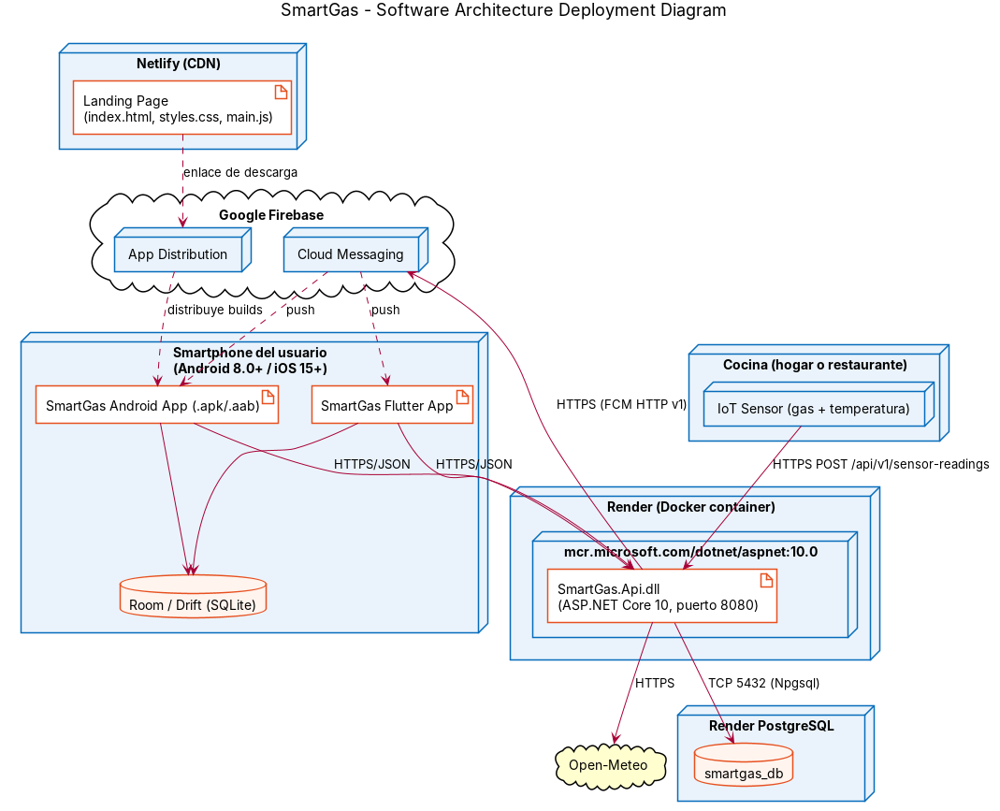
</div>

**Landing Page (Netlify)**

1. El repositorio Landing-Page mantiene en la raíz `index.html`, `styles.css`, `script.js` y la carpeta `images/`.
2. En Netlify se importa el repositorio desde GitHub (*Add new site → Import an existing project*), sin comando de build y con la raíz del repositorio como carpeta de publicación.
3. Cada push a la rama de producción publica automáticamente una nueva versión con HTTPS en https://smartgas-landingpage.netlify.app/.
4. Se verifica el sitio en un navegador de escritorio y en uno móvil, el cambio de idioma y los enlaces de descarga y de términos y condiciones.

**Web Services (Render con Docker)**

1. El repositorio Backend contiene un Dockerfile multietapa: compila con `mcr.microsoft.com/dotnet/sdk:10.0` y ejecuta con `mcr.microsoft.com/dotnet/aspnet:10.0` en el puerto 8080.
2. En Render se crea una base de datos PostgreSQL y un Web Service de tipo Docker conectado a la rama `main`.
3. Se configuran las variables de entorno `ConnectionStrings__DefaultConnection` (cadena de conexión de Render), `ASPNETCORE_ENVIRONMENT=Production` y, a partir del Sprint 2, `FIREBASE_CREDENTIALS_JSON` para el envío de notificaciones push.
4. Al iniciar, la aplicación aplica las migraciones de EF Core y carga los planes con `DatabaseSeeder`.
5. Se verifica el despliegue en `/swagger` y con una solicitud a `GET /api/v1/plans`.

```dockerfile
FROM mcr.microsoft.com/dotnet/sdk:10.0 AS build
WORKDIR /src
COPY ["SmartGas.Api.csproj", "./"]
RUN dotnet restore "SmartGas.Api.csproj"
COPY . .
RUN dotnet publish "SmartGas.Api.csproj" -c Release -o /app/publish /p:UseAppHost=false

FROM mcr.microsoft.com/dotnet/aspnet:10.0 AS final
WORKDIR /app
ENV ASPNETCORE_URLS=http://+:8080
EXPOSE 8080
COPY --from=build /app/publish .
ENTRYPOINT ["dotnet", "SmartGas.Api.dll"]
```

**App Android (Firebase App Distribution)**

1. Se registra la app `com.smartgas_frontend` en un proyecto de Firebase y se agrega `google-services.json` al módulo `app` (excluido del repositorio público mediante `.gitignore` y compartido por un canal privado).
2. La URL base de los web services se define por build type en `buildConfigField` (`API_BASE_URL`).
3. Se genera un APK firmado de release desde *Build → Generate Signed App Bundle / APK*, con el keystore del equipo guardado fuera del repositorio.
4. En Firebase App Distribution se sube el APK, se agregan los testers del grupo «firesecure-team» y del docente, y se envían las invitaciones.
5. La app se instala en un dispositivo físico desde el enlace de invitación para la demostración.

**App Flutter (Sprints 3 y 4).** Se distribuirá con el mismo proyecto de Firebase, generando el APK con `flutter build apk --release` y, para iOS, mediante TestFlight si se cuenta con una cuenta de Apple Developer.

## 4.2. Landing Page, Services & Applications Implementation

### 4.2.1. Sprint 1

#### 4.2.1.1. Sprint Planning 1

El Sprint 1 inicia el desarrollo móvil de SmartGas. Su planificación tomó como insumos el Product Backlog corregido tras el AV1, el landing page y los web services desarrollados en Aplicaciones Web, y el requisito del TB1: landing page desplegado, web services desplegados al 70 % y pantallas core de la aplicación.

| Sprint # | Sprint 1 |
|:--|:--|
| **Sprint Planning Background** | |
| Date | 2026-09-21 |
| Time | 08:00 PM |
| Location | Reunión virtual en Discord |
| Prepared By | Rioja Nuñez, Franco Diego |
| Attendees (to planning meeting) | Espinar Martínez, Gabriel Ferran / Guevara Serrano, Diego Ismael / Huaman Olivos, Yeira Shari / Rioja Nuñez, Franco Diego / Vivar Cesar, David Ignacio |
| Sprint n – 1 Review Summary | Es el primer sprint del curso. Como antecedente, en el AV1 se presentaron los Capítulos I y II; el docente aprobó la introducción, los User Personas, las Spike Stories, los Bounded Contexts y el C4, y pidió corregir el Problem Statement, las hipótesis, el análisis de entrevistas, los criterios de aceptación y el orden del backlog. |
| Sprint n – 1 Retrospective Summary | El equipo acordó trabajar cada capítulo en su propia rama, revisar los pull requests antes de integrarlos en develop, distribuir el desarrollo móvil entre los cinco integrantes y reunirse dos veces por semana. |
| **Sprint Goal & User Stories** | |
| Sprint 1 Goal | Our focus is on delivering the first native Android experience of SmartGas (real-time overall and zone status, active alerts, zone and sensor registration, and sign-up/sign-in) on top of the deployed web services, together with the updated landing page. We believe it delivers immediate visibility of kitchen risks to homeowners and restaurant managers, and a clear way for visitors to learn about SmartGas and download the app. This will be confirmed when a user signs in on a physical Android device and sees the overall status and every zone in less than 5 seconds, confirms an active alert, and visitors download the app from the deployed landing page. |
| Sprint 1 Velocity | 69 Story Points |
| Sum of Story Points | 69 Story Points |

#### 4.2.1.2. Aspect Leaders and Collaborators

Los aspectos del Sprint 1 corresponden a los productos de su alcance y al informe. Cada aspecto tiene un líder responsable de su calidad y colaboradores. Todos los integrantes colaboran en la app Android, porque el enunciado exige que cada uno evidencie su participación en la construcción de la experiencia móvil.

| Team Member (Last Name, First Name) | GitHub Username | Landing Page Leader (L) / Collaborator (C) | Web Services Leader (L) / Collaborator (C) | Android App Leader (L) / Collaborator (C) | UX/UI Design Leader (L) / Collaborator (C) | Project Report Leader (L) / Collaborator (C) |
|:--|:--|:--:|:--:|:--:|:--:|:--:|
| Espinar Martínez, Gabriel Ferran | zzZero14 | L | C | C | C | C |
| Guevara Serrano, Diego Ismael | Digetto | C | C | L | C | C |
| Huaman Olivos, Yeira Shari | YeiShari | C | C | C | L | C |
| Rioja Nuñez, Franco Diego | FrancoDiegoR | C | C | C | C | L |
| Vivar Cesar, David Ignacio | DarkBeider20 | C | L | C | C | C |

#### 4.2.1.3. Sprint Backlog 1

El objetivo del Sprint 1 es entregar la primera versión de la app Android con el monitoreo en tiempo real, las alertas activas y el registro de zonas, sensores y usuarios, apoyada en los web services desplegados, y publicar el landing page actualizado con la sección de descarga de la app.

Board del Sprint 1: [Sprint 1 · SmartGas](#) <!-- TODO: reemplazar # por el enlace del board de Trello -->

<div align="center">
  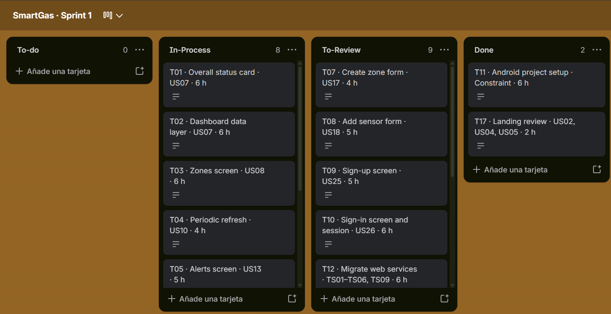
</div>

| User Story Id | User Story Title | Task Id | Task Title | Description | Estimation (Hours) | Assigned To | Status |
|:--|:--|:--|:--|:--|:--:|:--|:--|
| US07 | Ver el estado general de seguridad | T01 | Overall status card | Composable del banner de estado general y de los indicadores, con cálculo del estado a partir de los incidentes activos. | 6 | Diego Guevara | In-Process |
| US07 | Ver el estado general de seguridad | T02 | Dashboard data layer | `DashboardApiService` (Retrofit), `DashboardRepository` y `MonitoringViewModel` con `StateFlow`. | 6 | David Vivar | In-Process |
| US08 | Ver el estado de cada zona | T03 | Zones screen | Lista de zonas con estado, gas, temperatura y Filter Chips por estado. | 6 | Yeira Huaman | In-Process |
| US10 | Actualizar las lecturas automáticamente | T04 | Periodic refresh | Consulta cada 10 segundos con corrutinas, suspendida cuando la pantalla no está visible. | 4 | Diego Guevara | In-Process |
| US13 | Ver las alertas activas | T05 | Alerts screen | Lista de alertas activas ordenadas por severidad y fecha. | 5 | Franco Rioja | In-Process |
| US14 | Confirmar la recepción de una alerta | T06 | Confirm alert | Acción de confirmación con `PATCH /notifications/{id}/confirm` y actualización del estado en pantalla. | 4 | Franco Rioja | In-Process |
| US17 | Crear una zona | T07 | Create zone form | Formulario de nueva zona con manejo del error 409 por límite de plan. | 4 | Gabriel Espinar | To-Review |
| US18 | Registrar un sensor manualmente | T08 | Add sensor form | Formulario de registro con validación de código duplicado y de límite de plan. | 5 | Yeira Huaman | To-Review |
| US25 | Registrarse en la aplicación | T09 | Sign-up screen | Formulario de registro con selección de hogar o restaurante y aceptación de términos. | 5 | Gabriel Espinar | To-Review |
| US26 | Iniciar sesión | T10 | Sign-in screen and session | Pantallas de inicio de sesión y registro, `AccountRepository` y almacenamiento de la sesión con `SessionService`. | 6 | David Vivar | To-Review |
| — | Constraint general | T11 | Android project setup | Proyecto Kotlin con Jetpack Compose, Material 3, Navigation Compose, Retrofit, tema `SmartGasTheme` y recursos `strings.xml` en inglés y español. | 6 | Diego Guevara | Done |
| TS01–TS06, TS09 | Web services del Sprint 1 | T12 | Migrate web services | Migrar los web services al repositorio Backend de la organización del curso, revisar los endpoints y desplegarlos en Render. | 6 | David Vivar | To-Review |
| TS04 | Endpoint de recepción de lecturas | T13 | Severity unit tests | Pruebas unitarias de las reglas de severidad y de las transiciones de estado del incidente. | 5 | David Vivar | In-Process |
| US03 | Descargar la aplicación móvil | T14 | Get the app section | Nueva sección del landing page con capturas de la app y enlace de Firebase App Distribution, en inglés y español. | 5 | Gabriel Espinar | To-Review |
| US01 | Conocer la propuesta de valor | T15 | Update content and team | Actualizar la sección de equipo y reemplazar la característica de apagado automático por la respuesta guiada. | 3 | Gabriel Espinar | To-Review |
| US06 | Consultar los términos y condiciones | T16 | Terms page | Página de términos y condiciones enlazada desde el pie de página. | 2 | Franco Rioja | In-Process |
| US02, US04, US05 | Planes, contacto e idioma | T17 | Landing review | Verificar los precios, el formulario de contacto y el cambio de idioma heredados. | 2 | Gabriel Espinar | Done |
| SP01 | Spike ML Kit QR | T18 | QR proof of concept | Prueba de concepto con CameraX y ML Kit en dispositivo físico, e informe. | 12 | Yeira Huaman | To-Review |
| SP02 | Spike FCM vs OneSignal | T19 | Push proof of concept | Envío de un push de prueba desde el backend con la app cerrada, e informe comparativo. | 16 | Franco Rioja | To-Review |

#### 4.2.1.4. Development Evidence for Sprint Review

En el Sprint 1 se migró a la organización del curso el landing page desarrollado en Aplicaciones Web, se actualizó su sección de equipo y se desarrolló la primera versión de la app Android, organizada por bounded context (IAM, Kitchen Monitoring, Incidents y Subscriptions). Los web services se migraron al repositorio Backend con todo su historial (siete ramas y 26 commits), por lo que los commits de la base heredada pueden consultarse también en la organización del curso.

**Base heredada de Aplicaciones Web.** Los siguientes commits forman la base sobre la que se continúa el desarrollo (repositorios de la organización `upc-pre-2610-1ASI0730-12263-G2`):

| Repository | Branch | Commit Id | Commit Message | Commit Message Body | Committed on (Date) |
|:--|:--|:--|:--|:--|:--|
| SmartGas-website | main | d1093d0 | feat: add index.html from branches | Integra las secciones del landing page. | 24/04/2026 |
| SmartGas-website | main | ee01c35 | feat: add responsive design css sections | Estilos responsive. | 24/04/2026 |
| SmartGas-api | feature/iam-profiles-settings | b713e10 | feat: implement authentication endpoints | Registro e inicio de sesión. | 12/06/2026 |
| SmartGas-api | feature/monitoring-sensors-readings | 291cd83 | feat: implement zone management endpoints | Endpoints de zonas. | 12/06/2026 |
| SmartGas-api | feature/monitoring-sensors-readings | b14c8b3 | feat: implement sensor management endpoints | Endpoints de sensores. | 12/06/2026 |
| SmartGas-api | feature/monitoring-sensors-readings | 0284a31 | feat: implement iot sensor reading flow | Recepción de lecturas y creación de incidentes. | 12/06/2026 |
| SmartGas-api | feature/incidents-alerts-dashboard | 27d66da | feat: implement incident management endpoints | Ciclo de vida del incidente. | 13/06/2026 |
| SmartGas-api | feature/incidents-alerts-dashboard | c741046 | feat: implement alerts and notifications | Alertas y notificaciones. | 13/06/2026 |
| SmartGas-api | feature/incidents-alerts-dashboard | 3bc5e1f | feat: implement dashboard summary endpoints | Resumen del dashboard. | 13/06/2026 |
| SmartGas-api | feature/subscriptions-plans-weather | dc69236 | feat: integrate external weather service | Integración con Open-Meteo. | 12/06/2026 |

**Commits del Sprint 1 (organización del curso).**

| Repository | Branch | Commit Id | Commit Message | Commit Message Body | Committed on (Date) |
|:--|:--|:--|:--|:--|:--|
| Frontend | main | 26f69ef | Initial commit | Proyecto Android generado con Jetpack Compose. | 06/10/2026 |
| Frontend | main | 17fa84e | fix: Remove boilerplate Compose code from MainActivity | Base de develop y de las ramas feature. | 06/10/2026 |
| Frontend | main | feaac00 | feat(shared): configure app entry, navigation, api client and shared layout | Navegación, cliente Retrofit, sesión, tema y componentes compartidos. | 06/10/2026 |
| Frontend | main | d726d61 | feat(kitchen-monitoring): implement zone monitoring and device management | Pantallas de monitoreo de zonas y de sensores (US08, US17, US18). | 06/10/2026 |
| Frontend | main | f103e6a | feat(incidents): implement dashboard overview, incidents, notifications and reports | Dashboard, incidentes y alertas (US07, US13, US14). | 06/10/2026 |
| Frontend | main | b3ecea8 | feat(subscriptions): implement subscription management and en/es internationalization | Planes y suscripción, textos en inglés y español. | 06/10/2026 |
| Frontend | main | fb4fedc | feat(iam): implement authentication, profile and settings management | Registro, inicio de sesión, perfil y configuración (US25, US26). | 06/10/2026 |
| Landing-Page | main | 8ec8da5 | chore: initialize landing page from base project | Migración del landing page de Aplicaciones Web. | 05/10/2026 |
| Landing-Page | feature/about-us | 4d0a567 | feat(our team): team members | Actualización de la sección del equipo (US01). | 05/10/2026 |
| Landing-Page | develop | bbea410 | Merge pull request #1 from upc-pre-202610-1ACC0238-2620-4949/feature/about-us | feat(our team): team members | 05/10/2026 |
| Landing-Page | feature/our-team | 72f481d | feat(our team): team members | Ajustes de la sección del equipo. | 06/10/2026 |

#### 4.2.1.5. Testing Suite Evidence for Sprint Review

Las pruebas de aceptación se escriben en Gherkin, un archivo `.feature` por User Story, a partir de los criterios de aceptación de la sección 2.4.1. Los archivos se ubican en `SmartGas.Api.Tests/Features` (ejecutados con Reqnroll y xUnit) para las Technical Stories, y en `app/src/test/resources/features` para las historias de la app Android. A continuación se presentan los archivos del Sprint 1.

```gherkin
# US07-overall-status.feature
Feature: US07 View the overall safety status
  As a user
  I want to see the overall safety status of my kitchen when I open the app
  So that I know in seconds whether everything is fine

  Scenario: All zones are safe
    Given all zones of the user have readings within their thresholds
    When the user opens the application
    Then the app shows the overall status "Safe"
    And the app shows the number of zones and online sensors

  Scenario: There is an active critical incident
    Given at least one zone has an active incident with severity "Critical"
    When the user opens the application
    Then the app shows the overall status "Critical"
    And the app shows the affected zone

  Scenario: User without sensors
    Given the user has not registered any sensor
    When the user opens the application
    Then the app indicates that there are no sensors
    And the app offers to register the first sensor
```

```gherkin
# US14-confirm-alert.feature
Feature: US14 Confirm the reception of an alert
  As a user
  I want to confirm that I received an alert
  So that there is evidence that I am handling it

  Scenario: Successful confirmation
    Given there is an unconfirmed alert
    When the user confirms its reception
    Then the system records the confirmation with date and time
    And the alert is shown as confirmed

  Scenario: Confirmation without connection
    Given the device has no connection
    When the user confirms the reception of an alert
    Then the app stores the confirmation locally
    And the app sends it when the connection is restored
```

```gherkin
# TS04-sensor-readings.feature
Feature: TS04 Sensor readings endpoint
  As a developer
  I want an endpoint that receives sensor readings and evaluates the thresholds
  So that incidents are detected automatically

  Scenario Outline: Reading evaluation
    Given the account has a gas threshold of 50 and a temperature threshold of 45
    When the sensor "GLP-ST-01" sends a POST to "/api/v1/sensor-readings" with gas <gas> and temperature <temperature>
    Then the response status is 201
    And the field "incidentCreated" is <created>
    And the field "severity" is "<severity>"

    Examples:
      | gas | temperature | created | severity |
      | 20  | 30          | false   |          |
      | 60  | 30          | true    | High     |
      | 80  | 30          | true    | Critical |
      | 20  | 60          | true    | Critical |

  Scenario: Unknown sensor
    Given there is no sensor with code "XX-000"
    When the sensor "XX-000" sends a reading
    Then the response status is 404
```

```gherkin
# US18-register-sensor.feature
Feature: US18 Register a sensor manually
  As a user
  I want to register a sensor with its code, name, type and zone
  So that I can start monitoring that area

  Scenario: Sensor registered
    Given the user enters a sensor code that is not registered and an existing zone
    When the user confirms the registration
    Then the system registers the sensor with status "Online" in that zone

  Scenario: Duplicated code
    Given the code "GLP-ST-01" already belongs to another sensor
    When the user confirms the registration
    Then the system rejects the registration
    And the system informs that the code is already in use

  Scenario: Plan sensor limit reached
    Given the user has reached the maximum number of sensors of the plan
    When the user confirms the registration
    Then the system rejects the registration
    And the system indicates the limit of the plan
```

**Pruebas unitarias planificadas**

| Producto | Clase de prueba | Clase o comportamiento verificado |
|:--|:--|:--|
| Web Services | `SensorReadingServiceTests` | Tipo de incidente y severidad (High al superar el umbral; Critical con gas ≥ 1,5 × umbral o temperatura ≥ 1,3 × umbral). |
| Web Services | `IncidentServiceTests` | Transiciones a Reviewed, Resolved y FalseAlarm. |
| Web Services | `PlanLimitServiceTests` | Rechazo de zonas y sensores al alcanzar el límite del plan. |
| App Android | `MonitoringViewModelTest` | Cálculo del estado general y manejo de error con datos guardados. |
| App Android | `AuthViewModelTest` | Inicio de sesión exitoso y credenciales inválidas. |

Estas pruebas corresponden a la tarea T13, que sigue en curso al cierre del Sprint 1; sus commits se registrarán en el Sprint Review del Sprint 2.

#### 4.2.1.6. Execution Evidence for Sprint Review

En el Sprint 1 se dispone del landing page migrado y desplegado en Netlify y de la primera versión de la app Android con las pantallas core.

**Landing Page.** La versión desplegada presenta la propuesta de valor, los beneficios, las características, los planes, el equipo y el contacto, con selector de idioma.

<div align="center">
  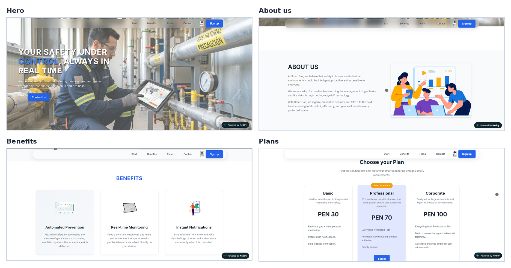
</div>

Diseño de la nueva sección *Get the SmartGas app* (tarea T14, en revisión; se publicará al aprobarse):

<div align="center">
  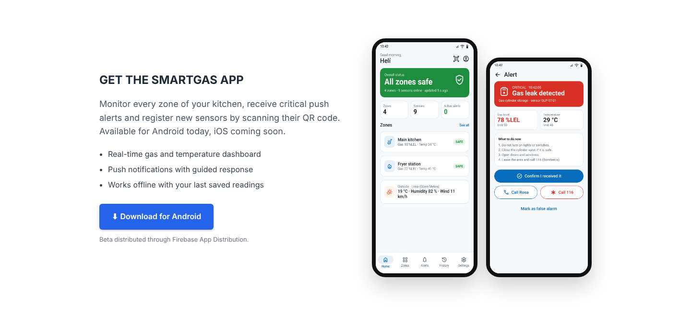
</div>

**App Android.** Pantallas de la primera versión de la app ejecutándose en un dispositivo físico y conectada a los web services: inicio de sesión, registro (con selección de tipo de cuenta), dashboard con el estado general y las zonas monitoreadas, monitoreo de zonas con filtros por estado y límite del plan, gestión de dispositivos IoT e incidentes con sus pestañas de activos, historial y notificaciones. Todas las pantallas incluyen el selector de idioma EN/ES.

<div align="center">
  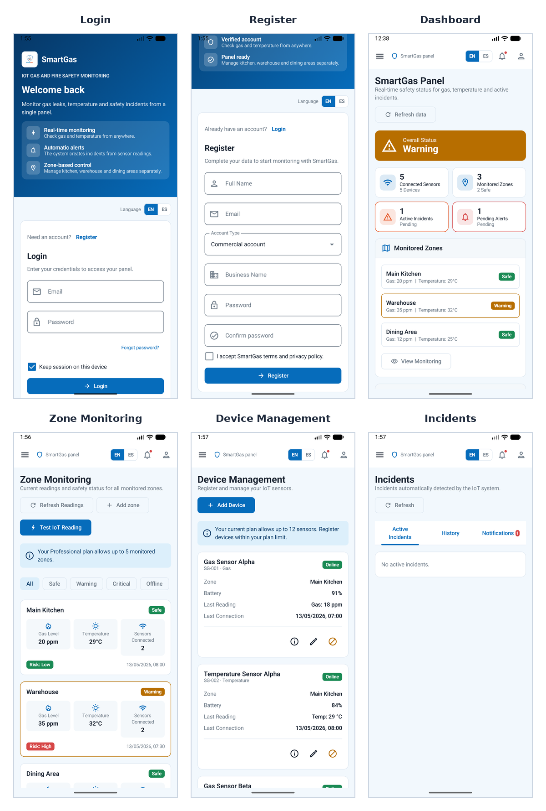
</div>

#### 4.2.1.7. Services Documentation Evidence for Sprint Review

Los web services documentan sus endpoints con OpenAPI 3.0 mediante Swashbuckle. En el Sprint 1 se revisaron y documentaron los endpoints que consume la app Android, que corresponden a las Technical Stories TS01 a TS06 y TS09, es decir, 7 de las 12 Technical Stories del producto. El repositorio Backend ya incluye además, heredados de Aplicaciones Web, los endpoints de perfil y contacto de emergencia (TS07), planes y suscripciones (TS08) y clima externo (TS10), por lo que implementa 10 de las 12 Technical Stories (83 %); se documentarán formalmente en los sprints en que se integran en la app. Quedan pendientes el envío de push con FCM (TS11, Sprint 2) y el reporte de seguridad (TS12, Sprint 4).

- **Repositorio:** https://github.com/upc-pre-202610-1ACC0238-2620-4949/Backend (migrado con su historial desde el repositorio de Aplicaciones Web)
- **Documentación desplegada:** https://smartgas-api-abop.onrender.com/swagger/index.html

| Endpoint | Verbo | Parámetros | Acción implementada | Respuesta |
|:--|:--|:--|:--|:--|
| `/api/v1/auth/sign-up` | POST | Body: email, password, fullName, businessName, phone, district, role | Registra una cuenta con plan Basic. | 201 AuthResponse · 409 correo duplicado |
| `/api/v1/auth/sign-in` | POST | Body: email, password | Valida las credenciales. | 200 AuthResponse · 401 |
| `/api/v1/profiles/{accountId}` | GET, PATCH | Path: accountId | Consulta y actualiza el perfil. | 200 ProfileResponse · 404 |
| `/api/v1/settings/{accountId}` | GET, PATCH | Path: accountId; body: language, darkMode, notificationsEnabled, gasThreshold, temperatureThreshold | Consulta y actualiza umbrales y preferencias. | 200 SettingResponse · 404 |
| `/api/v1/emergency-contacts/{accountId}` | GET, PATCH | Path: accountId; body: name, phone, email | Gestiona el contacto de emergencia. | 200 · 404 |
| `/api/v1/zones` | GET, POST | Query: accountId; body: accountId, name, description, sensitivity | Lista y crea zonas. | 200 / 201 · 409 límite de plan |
| `/api/v1/sensors` | GET, POST | Query: accountId; body: accountId, zoneId, code, name, type | Lista y registra sensores. | 200 / 201 · 409 |
| `/api/v1/sensors/{id}` | PATCH | Path: id; body: name, zoneId, status | Actualiza un sensor. | 200 · 404 |
| `/api/v1/sensor-readings` | GET, POST | Query: accountId; body: sensorCode, gasLevel, temperature | Consulta lecturas y registra una lectura con evaluación de umbrales. | 200 / 201 SensorReadingResponse · 404 |
| `/api/v1/incidents` | GET | Query: accountId | Lista los incidentes. | 200 |
| `/api/v1/incidents/{id}/review`, `/resolve`, `/false-alarm` | PATCH | Path: id | Cambia el estado del incidente. | 200 · 404 |
| `/api/v1/alerts` | GET | Query: accountId | Lista las alertas. | 200 |
| `/api/v1/notifications` | GET | Query: accountId | Lista las notificaciones. | 200 |
| `/api/v1/notifications/{id}/read`, `/confirm` | PATCH | Path: id | Marca como leída o confirmada. | 200 · 404 |
| `/api/v1/dashboard/summary/{accountId}` | GET | Path: accountId | Resumen del estado de seguridad. | 200 DashboardSummaryResponse · 404 |

**Ejemplo de interacción: registro de una lectura que genera un incidente crítico**

```http
POST /api/v1/sensor-readings HTTP/1.1
Host: smartgas-api-abop.onrender.com
Content-Type: application/json
Accept-Language: en-US

{ "sensorCode": "GLP-ST-01", "gasLevel": 78, "temperature": 29 }
```

```http
HTTP/1.1 201 Created
{
  "id": 1542, "accountId": 7, "zoneId": 3, "sensorId": 5,
  "gasLevel": 78, "temperature": 29, "createdAt": "2026-10-05T15:42:05Z",
  "incidentCreated": true, "incidentId": 128, "incidentType": "GasLeak",
  "severity": "Critical", "sensorStatus": "Critical", "zoneStatus": "Critical"
}
```

La lectura supera 1,5 veces el umbral de gas de la cuenta (50), por lo que el incidente se registra con severidad Critical y la zona cambia a ese estado.

**Capturas de la documentación en Swagger UI**

<div align="center">
  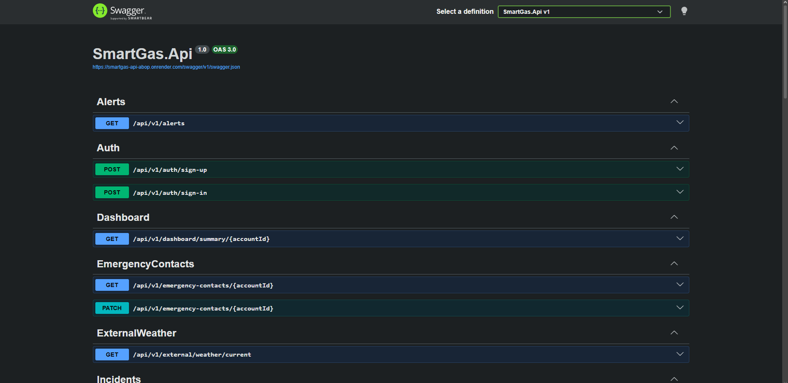
  <br><br>
  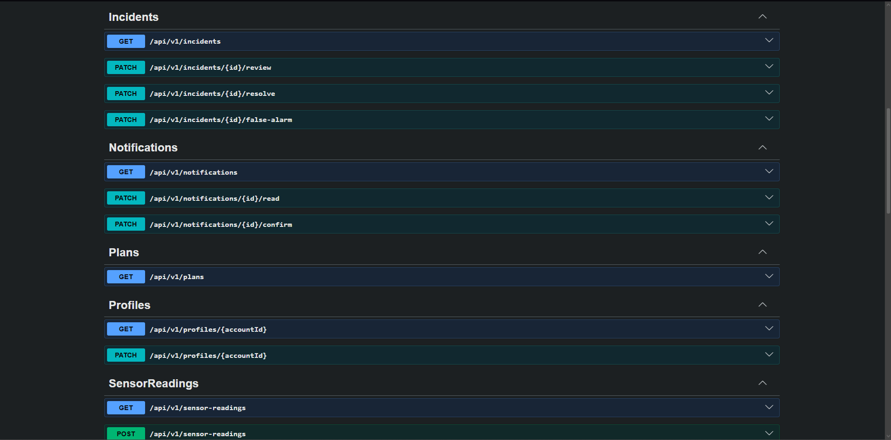
  <br><br>
  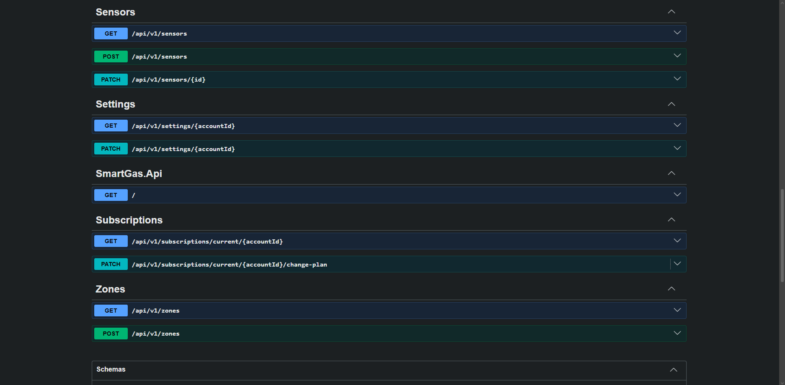
  <br><br>
  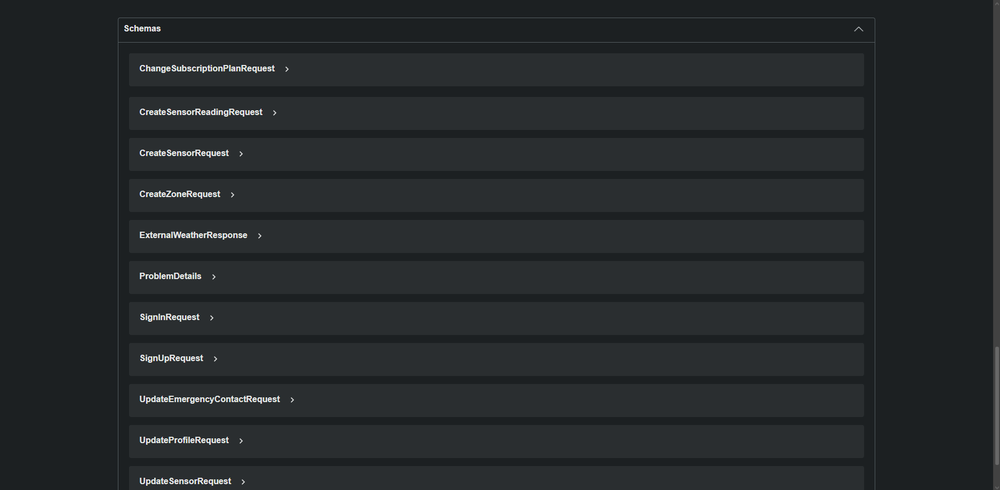
</div>

#### 4.2.1.8. Software Deployment Evidence for Sprint Review

En el Sprint 1 se realizaron las siguientes actividades de despliegue:

| Producto | Plataforma | URL | Estado |
|:--|:--|:--|:--|
| Landing Page | Netlify | https://smartgas-landingpage.netlify.app/ | Desplegado |
| Web Services | Render (Docker) + PostgreSQL | https://smartgas-api-abop.onrender.com/swagger/index.html | Desplegado |
| App Android | Dispositivo físico (APK de depuración desde Android Studio) | — | Primera versión ejecutable |

1. **Landing page.** Se importó el proyecto de Aplicaciones Web al repositorio Landing-Page, se conectó el repositorio con Netlify y se verificó el sitio en escritorio y en móvil.
2. **Web services.** Se migró el código con su historial al repositorio Backend; el servicio de Render se mantiene conectado al repositorio de Aplicaciones Web y se reconectará al repositorio Backend en el Sprint 2, se configuró la variable `ConnectionStrings__DefaultConnection` y se verificaron Swagger y el endpoint `GET /api/v1/plans`. Como Render suspende los servicios gratuitos tras un periodo sin tráfico, la primera solicitud después de la inactividad puede tardar alrededor de un minuto; la app muestra un indicador de carga durante ese tiempo.
3. **App Android.** Se ejecutó la app en dispositivos físicos desde Android Studio. La URL base de los web services se define en `Constants.BASE_URL`; para conectarse al despliegue de Render debe apuntar a `https://smartgas-api-abop.onrender.com/api/v1/`. La distribución con Firebase App Distribution se realizará en el Sprint 2, junto con las notificaciones push.

<table>
  <tr>
    <td align="center">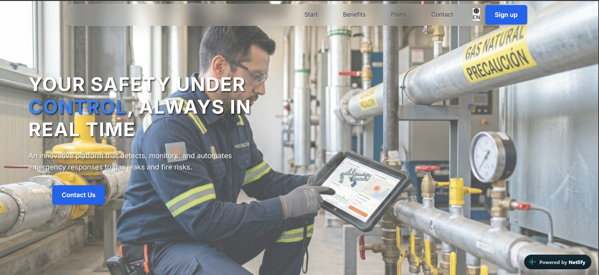<br><em>Landing page en Netlify</em></td>
    <td align="center">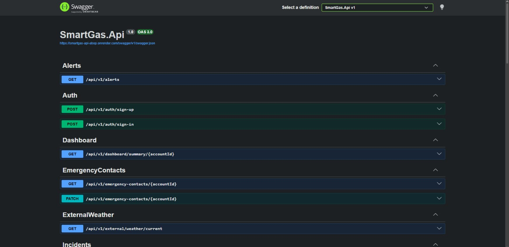<br><em>Web services en Render</em></td>
  </tr>
</table>

#### 4.2.1.9. Team Collaboration Insights during Sprint

Durante el Sprint 1 el equipo creó en cada repositorio las ramas `main` y `develop` y una rama feature por bounded context (en Frontend: `feature/frontend-base-config-deployment`, `feature/monitoring-devices`, `feature/incidents-dashboard-reports`, `feature/subscriptions-i18n-accessibility` y `feature/iam-profile-settings`). En Landing-Page, la actualización del equipo se integró a develop mediante el pull request #1. En Frontend, la primera versión de la app se integró directamente en main; a partir del Sprint 2 cada feature se integrará mediante pull request hacia develop, revisado por otro integrante. La coordinación se realizó en Discord y en el board de Trello.

<div align="center">
  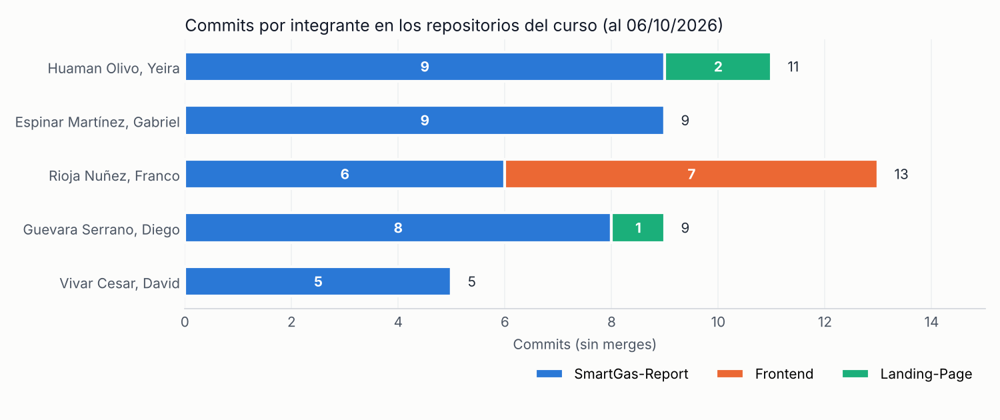
</div>

*Fuente: historial de git de los repositorios SmartGas-Report, Frontend y Landing-Page (todas las ramas, sin commits de merge), al 6 de octubre de 2026. El repositorio Backend no se incluye porque su historial corresponde al desarrollo de Aplicaciones Web.*

El gráfico muestra que la participación en el informe está distribuida entre los cinco integrantes, mientras que el código del Sprint 1 se concentró en pocos integrantes: Franco Rioja registró los siete commits de la app Android y Yeira Huaman y Diego Guevara los del landing page. Como acción de mejora para el Sprint 2, cada integrante desarrollará al menos una User Story de la app en su propia rama feature y la integrará mediante pull request, para que la contribución al código quede registrada de forma equilibrada.

## 4.3. Validation Interviews

Las entrevistas de validación se realizarán con la versión de la app distribuida en el Sprint 2, con usuarios de ambos segmentos, y combinarán la observación de tareas con la evaluación según heurísticas. En el TB1 se presenta su diseño y una evaluación heurística interna del prototipo realizada por el equipo.

### 4.3.1. Diseño de Entrevistas

**Objetivo.** Validar si los usuarios comprenden el estado de su cocina, reaccionan correctamente ante una alerta y registran un sensor sin ayuda, usando el landing page y la app instalada en un dispositivo físico.

**Participantes.** De tres a cinco por segmento, priorizando a quienes participaron en las entrevistas iniciales (Saúl, Sheila y Sonia; Raí, Kevin y Rubén).

**Elementos a evaluar y tareas**

| Producto | Tarea | User flow asociado | Segmento |
|:--|:--|:--|:--|
| Landing Page | Encontrar el precio del plan Professional y descargar la app. | — | Ambos |
| App | Iniciar sesión y decir en voz alta el estado de la cocina. | User Flow 1 | Ambos |
| App | Responder a una alerta crítica simulada y llamar al contacto de emergencia. | User Flow 2 | Ambos |
| App | Registrar un nuevo sensor escaneando su QR. | User Flow 3 | Restaurantes |
| App | Encontrar los incidentes de la última semana y resolver uno. | User Flow 4 | Restaurantes |
| App | Cambiar el umbral de gas y el idioma a español. | User Flow 5 | Hogares |

**Preguntas después de las tareas**

1. ¿Qué fue lo primero que entendió al abrir la app?
2. Cuando recibió la alerta, ¿supo qué hacer? ¿Qué le faltó?
3. ¿Qué tan fácil le resultó registrar el sensor? (escala del 1 al 5)
4. ¿Qué información adicional necesitaría para confiar en las alertas?
5. ¿Cuánto estaría dispuesto a pagar al mes por SmartGas? ¿Qué plan elegiría?
6. ¿Recomendaría SmartGas a un familiar o a otro negocio? ¿Por qué?

### 4.3.2. Registro de Entrevistas

Las entrevistas de validación se registrarán en el Sprint 2 (AV2) con el formato de la sección 2.2.2: nombre, edad, distrito, captura del video, inicio, duración, enlace y resumen de las apreciaciones del entrevistado sobre cada tarea.

### 4.3.3. Evaluaciones según heurísticas

Como paso previo a las entrevistas con usuarios, el equipo realizó una evaluación heurística interna de los mock-ups y del prototipo de la app, según el formato del Anexo E del enunciado.

| | |
|:--|:--|
| **CARRERA** | Ingeniería de Software |
| **CURSO** | 1ACC0238 Aplicaciones para Dispositivos Móviles |
| **NRC** | 4949 |
| **PROFESORES** | Quevedo Velasco, David Gerardo |
| **AUDITOR** | FireSecure (evaluación interna) |
| **CLIENTE(S)** | Integrantes de FireSecure en el rol de usuarios de ambos segmentos |

**SITE o APP A EVALUAR:** SmartGas (prototipo de la app Android, Sprint 1).

**TAREAS A EVALUAR.** El alcance de esta evaluación incluye la revisión de la usabilidad de las siguientes tareas:

1. Inicio de sesión de un usuario registrado.
2. Revisión del estado general y del estado de cada zona.
3. Respuesta a una alerta crítica.
4. Registro de un sensor mediante QR.
5. Consulta y filtrado del historial de incidentes.
6. Configuración de umbrales.

No están incluidas en esta versión de la evaluación las siguientes tareas:

1. Cambio de plan.
2. Uso de la app en iOS.
3. Reporte de seguridad.

**ESCALA DE SEVERIDAD**

| Nivel | Descripción |
|:--:|:--|
| 1 | Problema superficial: puede ser fácilmente superado por el usuario y ocurre con muy poca frecuencia. No necesita arreglarse a menos que exista disponibilidad de tiempo. |
| 2 | Problema menor: puede ocurrir con algo más de frecuencia o es un poco más difícil de superar. Se le debería asignar una prioridad baja para el siguiente release. |
| 3 | Problema mayor: ocurre con frecuencia o los usuarios no son capaces de resolverlo. Es importante corregirlo y se le debe asignar una prioridad alta. |
| 4 | Problema muy grave: impide al usuario continuar con el uso de la herramienta. Es imperativo corregirlo antes del lanzamiento. |

**TABLA RESUMEN**

| # | Problema | Escala de severidad | Heurística o principio violado |
|:--:|:--|:--:|:--|
| 1 | La acción «Mark as false alarm» está cerca de las acciones de emergencia y no pide confirmación. | 3 | Usability: Prevención de errores |
| 2 | La pantalla de escaneo QR no ofrece un acceso directo al ingreso manual del código. | 2 | Usability: Libertad y control del usuario |
| 3 | Los sliders de umbrales no permiten ingresar el valor exacto, lo que dificulta su uso con lectores de pantalla o con poca precisión motriz. | 2 | Inclusive Design: Ofrece opciones |
| 4 | La barra de nivel de gas de cada zona muestra «limit 50» sin unidad de medida. | 1 | Usability: Consistencia y estándares |
| 5 | El historial no indica qué filtros están activos cuando se vuelve a la pantalla. | 2 | Information Architecture: Is it findable? |

**DESCRIPCIÓN DE PROBLEMAS**

**Problema 1: la acción «Mark as false alarm» no pide confirmación.**<br>
Severidad: 3. Heurística violada: Usability · Prevención de errores.<br>
Problema: en el detalle de la alerta, el usuario puede descartar una fuga real con un toque accidental, en un momento de estrés.<br>
Recomendación: solicitar una confirmación con un diálogo que repita el valor medido y ubicar la acción al final de la pantalla, separada de las acciones de emergencia.

<div align="center">
  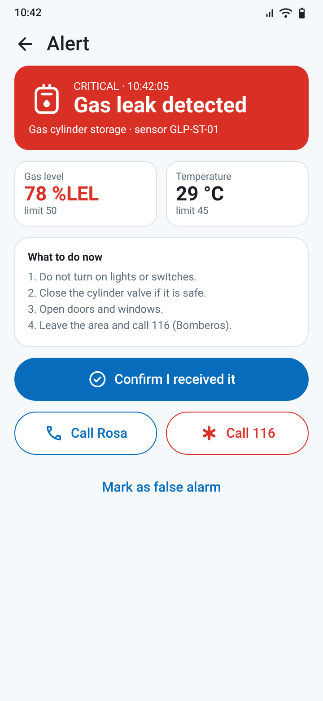
</div>

**Problema 2: no hay acceso directo al ingreso manual desde el escáner.**<br>
Severidad: 2. Heurística violada: Usability · Libertad y control del usuario.<br>
Problema: si el QR está dañado, el usuario debe cerrar el escáner para volver al formulario.<br>
Recomendación: agregar la acción «Enter code manually» en la parte inferior del escáner.

<div align="center">
  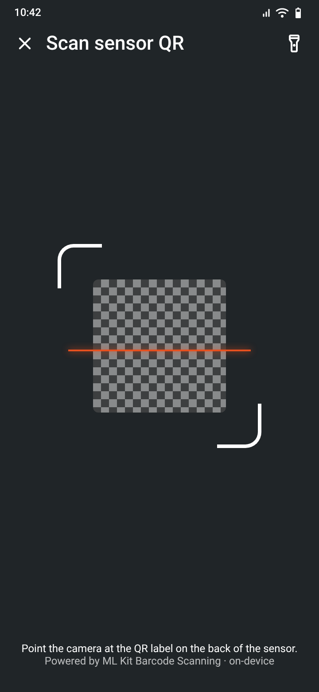
</div>

**Problema 3: los umbrales solo se ajustan con sliders.**<br>
Severidad: 2. Heurística violada: Inclusive Design · Ofrece opciones.<br>
Problema: con un slider es difícil fijar un valor exacto y TalkBack solo permite cambiarlo por pasos.<br>
Recomendación: acompañar cada slider de un campo numérico editable y configurar los pasos del slider de 5 en 5.

<div align="center">
  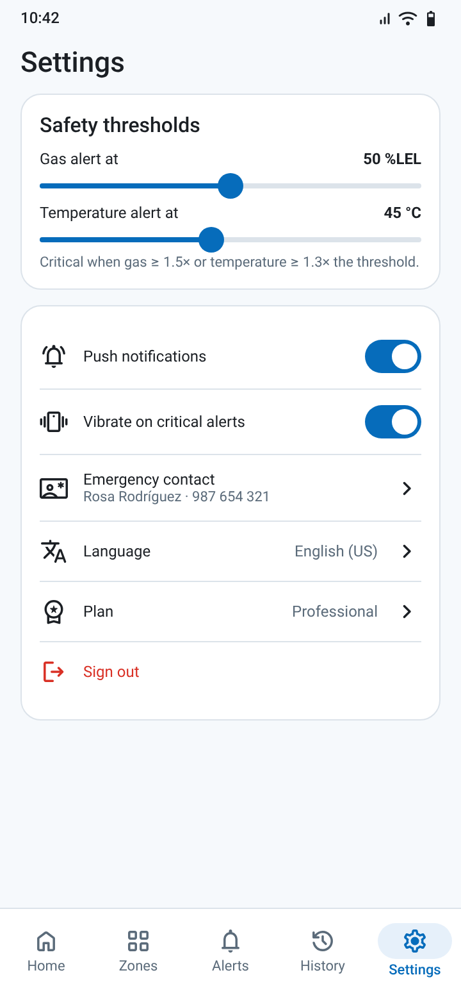
</div>

**Problema 4: el límite de gas aparece sin unidad.**<br>
Severidad: 1. Heurística violada: Usability · Consistencia y estándares.<br>
Problema: en la lista de zonas se muestra «limit 50», mientras que en el resto de la app se usa «%LEL».<br>
Recomendación: mostrar «limit 50 %LEL» en todas las vistas.

**Problema 5: los filtros activos del historial no son visibles.**<br>
Severidad: 2. Heurística violada: Information Architecture · Is it findable?<br>
Problema: al volver al historial, el usuario no sabe si la lista está filtrada.<br>
Recomendación: mostrar los filtros aplicados como chips seleccionados con la opción «Clear filters».

Los cinco problemas se registraron como tareas en el Sprint Backlog 2.


# Conclusiones

## Conclusiones y recomendaciones

### Conclusiones

1. **Sobre el Problem Statement.** Las entrevistas confirmaron el problema planteado: el 100 % de las familias y de los restaurantes entrevistados supervisa su cocina de forma manual y no tiene forma de saber qué ocurre cuando no está presente. La reformulación del Problem Statement con la plantilla *Brand new initiative*, en un único enunciado para ambos segmentos, permitió fijar métricas de éxito observables, como confirmar el 80 % de las alertas críticas en menos de 2 minutos.
2. **Sobre las assumptions.** Se confirmaron, con la evidencia disponible, las suposiciones de usuario: el celular es el canal principal (UA1) y la alerta inmediata es la necesidad más valorada (67 % en hogares y 100 % en restaurantes). Las suposiciones de negocio, en particular la disposición a pagar una suscripción (BA1) y la migración entre planes (BOA2), aún no se validan y se medirán en las entrevistas de validación.
3. **Sobre las hipótesis.** Las hipótesis H1 (dashboard) y H2 (alertas push con guía) guiaron la priorización del Product Backlog: las historias que las sustentan ocupan los primeros lugares y se implementan en los Sprints 1 y 2. Su validación cuantitativa se hará con la versión distribuida mediante Firebase App Distribution.
4. **Sobre el diseño de la solución.** El enfoque Domain-Driven Design permitió reutilizar los web services de Aplicaciones Web, cuyos bounded contexts se ajustaron tras contrastarlos con el código: se incorporó Payment Management y las integraciones externas se modelaron como Anti-Corruption Layers. El C4 Model documenta ahora los cinco productos de la solución, incluidas las dos aplicaciones móviles.
5. **Sobre la experiencia móvil.** Los wireflows, user flows y mock-ups muestran que los flujos críticos se completan en pocos pasos: la respuesta a una alerta requiere dos interacciones desde la notificación. La evaluación heurística interna identificó cinco problemas, el más grave relacionado con la prevención de errores al marcar una falsa alarma, que se corregirán en el Sprint 2.

### Recomendaciones y próximos pasos (roadmap)

- **Sprint 2 (AV2):** completar los web services (FCM, registro de dispositivos y planes), implementar las alertas push, el historial, los umbrales y el registro por QR en Android, corregir los hallazgos heurísticos y realizar las entrevistas de validación.
- **Sprints 3 y 4 (TB2):** construir la app en Flutter con paridad funcional para iOS, el modo sin conexión con Drift, el reporte de seguridad y la gestión de suscripciones; distribuir ambas apps con Firebase App Distribution.
- **Después del curso:** evaluar la integración con actuadores (válvulas y extractores), SMS como canal de respaldo para el plan Corporate, el panel multi-local para cadenas de restaurantes y la autenticación con JWT y doble factor.

## Video About-the-Team

El video About-the-Team se presentará en su primera versión en el AV2 y en su versión final en el TB2. Incluirá la presentación de cada integrante ante cámara, escenas de las sesiones de trabajo del equipo (EventStorming, Sprint Planning y desarrollo de la app) con narración en voz en off, y el testimonio de cada integrante sobre las actividades realizadas y el desarrollo del Student Outcome.

| Elemento | Detalle |
|:--|:--|
| Nomenclatura | `upc-pre-202620-1acc0238-4949-firesecure-about-the-team-av2.mp4` |
| Duración estimada | 10 minutos (5 minutos de retrospectiva y 1 minuto por testimonio) |
| Entrega | AV2 (primera versión) y TB2 (versión final) |

## Video About-the-Product

El video About-the-Product, de uno a dos minutos, presentará el problema, la propuesta de valor de SmartGas, escenas de la app en uso y al menos un testimonio de un usuario de las entrevistas de validación. Se publicará en el OneDrive del curso y en YouTube para incrustarlo en el landing page. Su primera versión se entregará en el AV2.

## Video App Validation

El video App Validation documentará las sesiones de prueba con usuarios de la versión distribuida mediante Firebase App Distribution y su evaluación según el formato de heurísticas del Anexo E. Se elaborará a partir del Sprint 2.

# Glosario

| Término | Definición |
|:--|:--|
| ACL (Anti-Corruption Layer) | Capa que traduce el modelo de un sistema externo al modelo propio para no contaminar el dominio. |
| Aggregate Root | Entidad principal de un agregado de DDD; es el único punto de acceso para modificarlo. |
| API (Application Programming Interface) | Conjunto de operaciones que un sistema expone para que otros lo usen. |
| APK | Formato de paquete de instalación de las apps Android. |
| ASO (App Store Optimization) | Optimización de la ficha de una app en las tiendas para mejorar su visibilidad. |
| Bounded Context | Límite dentro del cual un modelo de dominio y su lenguaje son consistentes. |
| C4 Model | Modelo de Simon Brown para representar la arquitectura en cuatro niveles: contexto, contenedores, componentes y código. |
| Conventional Commits | Convención para redactar mensajes de commit con un tipo y una descripción estandarizados. |
| DDD (Domain-Driven Design) | Enfoque de diseño de software centrado en el dominio del negocio y su lenguaje. |
| DTO (Data Transfer Object) | Objeto que transporta datos entre capas o sistemas, sin lógica de negocio. |
| EF Core | Entity Framework Core, mapeador objeto-relacional de .NET. |
| EventStorming | Técnica colaborativa para explorar un dominio a partir de sus eventos. |
| FCM (Firebase Cloud Messaging) | Servicio de Google para enviar notificaciones push. |
| Gherkin | Lenguaje estructurado (Given-When-Then) para escribir criterios de aceptación y pruebas BDD. |
| GitFlow | Modelo de ramificación con ramas main, develop, feature, release y hotfix. |
| i18n / a11y | Abreviaturas de internacionalización (*internationalization*) y accesibilidad (*accessibility*). |
| IoT (Internet of Things) | Dispositivos físicos conectados que envían datos por la red. |
| Jetpack Compose | Toolkit declarativo de Android para construir interfaces en Kotlin. |
| Lean UX | Enfoque de diseño que formula hipótesis y las valida rápidamente con usuarios. |
| Material Design 3 | Sistema de diseño de Google usado en la app. |
| ML Kit | Conjunto de SDK de aprendizaje automático de Google que se ejecutan en el dispositivo. |
| OpenAPI / Swagger | Especificación y herramienta para documentar APIs REST. |
| Push notification | Mensaje que el servidor envía al dispositivo aunque la app esté cerrada. |
| RESTful API | API que sigue el estilo arquitectónico REST sobre HTTP. |
| Room | Biblioteca de persistencia local de Android sobre SQLite. |
| Semantic Versioning | Esquema de versiones MAJOR.MINOR.PATCH. |
| Spike | Historia de investigación con tiempo limitado para reducir incertidumbre técnica. |
| Sprint | Iteración de duración fija en Scrum en la que se entrega un incremento. |
| Story Points | Unidad relativa para estimar el esfuerzo de una historia. |
| UX / UI | Experiencia de usuario e interfaz de usuario. |
| Wireflow | Diagrama que combina wireframes con las interacciones que conectan las pantallas. |

# Bibliografía

Las referencias se organizan según las categorías del Anexo G del enunciado. Los cuatro artículos académicos requeridos, publicados en revistas Q1 o Q2 en 2024 o 2025, se identifican con (★).

**Dominio de negocio**

- (★) Abdullahi, U. I., Zhang, W., Cao, Y., & Irankunda, G. (2025). Integrating IoT technology for fire risk monitoring and assessment in residential building design. *Buildings, 15*(8), Artículo 1346. https://doi.org/10.3390/buildings15081346
- Android Authority. (2025, 28 de marzo). *Google is retiring the Nest Protect*. https://androidauthority.com/nest-protect-retired-3539328
- Andina. (2025, 7 de junio). *Más de 7 millones de hogares cocinan con GLP y 650,000 vehículos lo usan como combustible*. https://andina.pe/agencia/noticia-mas-7-millones-hogares-cocinan-glp-y-650000-vehiculos-usan-como-combustible-1032628.aspx
- Gestión. (2024a, 18 de diciembre). *Bomberos atendieron 30 incendios al día este 2024: ¿cómo evitar siniestros en esta época del año?* https://gestion.pe/peru/bomberos-atendieron-30-incendios-al-dia-este-2024-como-evitar-siniestros-en-esta-epoca-del-ano-noticia/
- Gestión. (2024b, 26 de diciembre). *INEI: 88.6% de hogares peruanos cocinan con gas*. https://gestion.pe/economia/inei-886-de-hogares-peruanos-cocinan-con-gas-enaho-noticia/
- (★) Landi, E., Parri, L., Baldo, D., Parrino, S., Vatansever, T., Fort, A., Mugnaini, M., & Vignoli, V. (2025). Reliability and performance evaluation of IoT-based gas leakage detection systems for residential environments. *Electronics, 14*(19), Artículo 3798. https://doi.org/10.3390/electronics14193798
- Perú Retail. (2025, 26 de mayo). *INEI: actividad de restaurantes en Perú aumentó 1.34% en marzo de 2025*. https://www.peru-retail.com/?p=372889

**Métodos, técnicas y approaches de ingeniería de software**

- Brown, S. (s. f.). *The C4 model for visualising software architecture*. https://c4model.com
- Conventional Commits. (s. f.). *Conventional Commits 1.0.0*. https://www.conventionalcommits.org/en/v1.0.0/
- Driessen, V. (2010, 5 de enero). *A successful Git branching model*. https://nvie.com/posts/a-successful-git-branching-model/
- Evans, E. (2003). *Domain-driven design: Tackling complexity in the heart of software*. Addison-Wesley.
- Gothelf, J., & Seiden, J. (2021). *Lean UX: Designing great products with agile teams* (3.ª ed.). O'Reilly Media.
- (★) Mahmud, T., Che, M., Ngu, A., & Yang, G. (2025). Why Android app testing falls short: Empirical insights from open-source projects and a practitioner survey. *Empirical Software Engineering, 30*(6). https://doi.org/10.1007/s10664-025-10726-x
- Moran, K. (2016, 17 de julio). *The four dimensions of tone of voice*. Nielsen Norman Group. https://www.nngroup.com/articles/tone-of-voice-dimensions/
- Preston-Werner, T. (s. f.). *Semantic Versioning 2.0.0*. https://semver.org
- (★) Rua, R., & Saraiva, J. (2024). A large-scale empirical study on mobile performance: Energy, run-time and memory. *Empirical Software Engineering, 29*(1), Artículo 31. https://doi.org/10.1007/s10664-023-10391-y
- Schwaber, K., & Sutherland, J. (2020). *The Scrum guide*. https://scrumguides.org
- Vernon, V. (2016). *Domain-driven design distilled*. Addison-Wesley.
- W3C. (2018). *Web Content Accessibility Guidelines (WCAG) 2.1*. https://www.w3.org/TR/WCAG21/

**Lenguajes, frameworks y herramientas**

- Android Developers. (s. f.-a). *Core app quality guidelines*. https://developer.android.com/docs/quality-guidelines/core-app-quality
- Android Developers. (s. f.-b). *Guide to app architecture*. https://developer.android.com/topic/architecture
- Android Developers. (s. f.-c). *Jetpack Compose tutorial*. https://developer.android.com/jetpack/compose/tutorial
- Bailey, T., & Biessek, A. (2026). *Flutter for beginners* (4.ª ed.). Packt Publishing.
- Firebase. (s. f.-a). *Firebase App Distribution*. https://firebase.google.com/docs/app-distribution
- Firebase. (s. f.-b). *Firebase Cloud Messaging*. https://firebase.google.com/docs/cloud-messaging
- Forrester, A., Boudjnah, E., Dumbravan, A., & Tigcal, J. (2025). *How to build Android applications with Kotlin* (3.ª ed.). Packt Publishing.
- Google. (s. f.). *Barcode scanning · ML Kit*. https://developers.google.com/ml-kit/vision/barcode-scanning
- Künneth, T. (2023). *Android UI development with Jetpack Compose* (2.ª ed.). Packt Publishing.
- Microsoft. (s. f.-a). *ASP.NET Core documentation*. https://learn.microsoft.com/aspnet/core
- Microsoft. (s. f.-b). *C# coding conventions*. https://learn.microsoft.com/dotnet/csharp/fundamentals/coding-style/coding-conventions
- Open-Meteo. (s. f.). *Weather forecast API*. https://open-meteo.com/en/docs
- Structurizr. (s. f.). *Structurizr DSL*. https://docs.structurizr.com/dsl

**Ética profesional**

- ACM & IEEE Computer Society. (1999). *Software engineering code of ethics and professional practice*. https://www.acm.org/code-of-ethics/software-engineering-code
- Colegio de Ingenieros del Perú. (2018). *Código de ética del CIP*. https://www.cip.org.pe/publicaciones/reglamentosCNCD2018/codigo_de_etica_del_cip.pdf

# Anexos

## Anexo A. Videos

| Video | Entrega | Enlace |
|:--|:--|:--|
| Entrevistas de needfinding | AV1 | Enlaces individuales de OneDrive en la sección 2.2.2 |

## Anexo B. Términos y condiciones de SmartGas

Última actualización: 5 de octubre de 2026. Estos términos se muestran en el pie de página del landing page y deben aceptarse al crear una cuenta en la app.

1. **Objeto del servicio.** SmartGas, de FireSecure, es un servicio de monitoreo que muestra lecturas de gas y temperatura de sensores compatibles y envía alertas al usuario. SmartGas es una herramienta de apoyo para la prevención; no reemplaza a los detectores certificados, a las inspecciones técnicas ni a los servicios de emergencia. Ante una emergencia, el usuario debe llamar a los Bomberos (116).
2. **Cuenta del usuario.** El usuario es responsable de la veracidad de sus datos, de la confidencialidad de su contraseña y de mantener actualizado su contacto de emergencia.
3. **Funcionamiento de las alertas.** La entrega de las alertas depende de la conexión a internet del sensor y del dispositivo, del estado de la batería del sensor y de que el usuario mantenga activas las notificaciones. FireSecure informará con transparencia cualquier interrupción del servicio.
4. **Datos personales.** FireSecure recopila solo los datos necesarios para prestar el servicio (correo, nombre, teléfono, distrito, lecturas, incidentes y token del dispositivo), los trata conforme a la Ley N.º 29733, Ley de Protección de Datos Personales del Perú, no los vende a terceros y los comparte únicamente con los proveedores necesarios para operar (alojamiento en la nube y notificaciones push). El usuario puede solicitar el acceso, la rectificación o la eliminación de sus datos escribiendo a privacidad@firesecure.pe.
5. **Cámara y permisos.** La cámara se usa solo para leer el código QR de los sensores; las imágenes se procesan en el dispositivo y no se almacenan ni se envían.
6. **Planes y pagos.** Los precios de los planes se expresan en soles e incluyen impuestos. El usuario puede cambiar de plan o cancelar su suscripción en cualquier momento; la cancelación surte efecto al final del periodo pagado.
7. **Responsabilidad profesional.** FireSecure desarrolla SmartGas siguiendo el *Software Engineering Code of Ethics and Professional Practice* de ACM/IEEE-CS y el Código de Ética del Colegio de Ingenieros del Perú: prioriza la seguridad y el bienestar del público, comunica las limitaciones del producto y no diseña la app para fomentar un uso compulsivo.
8. **Modificaciones.** FireSecure notificará en la app cualquier cambio en estos términos con al menos 15 días de anticipación.

## Anexo C. Fuentes de los diagramas

Los diagramas de arquitectura y de diseño táctico se mantienen como código en la carpeta `diagrams/` del repositorio del informe:

| Archivo | Contenido |
|:--|:--|
| `diagrams/workspace.dsl` | Modelo C4 completo en Structurizr DSL (contexto, contenedores, componentes y despliegue). |
| `diagrams/c4-*.puml`, `diagrams/deployment.puml` | Diagramas C4 y de despliegue en C4-PlantUML. |
| `diagrams/context-map.puml` | Context Map. |
| `diagrams/tactical/class-*.puml` | Diagramas de clases del Domain Layer por bounded context. |
| `diagrams/tactical/comp-*.puml` | Diagramas de componentes por bounded context. |
| `diagrams/tactical/db-*.puml` | Diagramas de base de datos por bounded context y base de datos local Room. |


